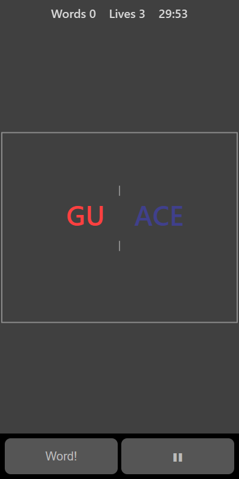

[Home](../../README.md) > [Words](README.md) > Word Loom

In Word Loom, two halves of a five-letter word slide in from the left and the right and meet in the middle. Sometimes they make a real word, and sometimes they don't. Tap when they make a real word. Leave them alone when they don't.

## How to play

1. Tap **Play**. A pair of halves starts sliding towards the middle.
2. When they meet, a frame appears round them and they start to fade.
3. If they spell a real word, tap before they fade.
4. If they don't, do nothing and let them fade.
5. After each pair you see whether you were right, and what the word was.
6. Getting it wrong costs a life. That means tapping a fake or missing a real word. You have 3 lives.
7. The halves move faster as your score goes up.

## Controls

| Action      | Touch                        | Keyboard       | Controller |
|-------------|------------------------------|----------------|------------|
| It's a word | Tap anywhere, or **Word!**   | Space or Enter | A          |
| Pause       | ❚❚                           | P or Escape    | Start      |

Taps only count once the halves have met.

## What each eye sees

| Weaker eye         | Stronger eye        | Both eyes                   |
|--------------------|---------------------|-----------------------------|
| The left halves    | The right halves    | The centre marks, frame and results |

You can only read the whole word when both eyes are working together.

## Difficulty

| Setting | How fast the halves arrive | How long you have to decide |
|---------|----------------------------|-----------------------------|
| Easy    | Slowest                    | Longest                     |
| Normal  | Medium                     | Medium                      |
| Hard    | Fastest                    | Shortest                    |

## Scoring

One point for each real word you spot. The top bar shows your score and lives.

## Tips

* Read the word as a whole rather than half by half.
* Fakes often look nearly right. If a word looks odd, it probably isn't real.
