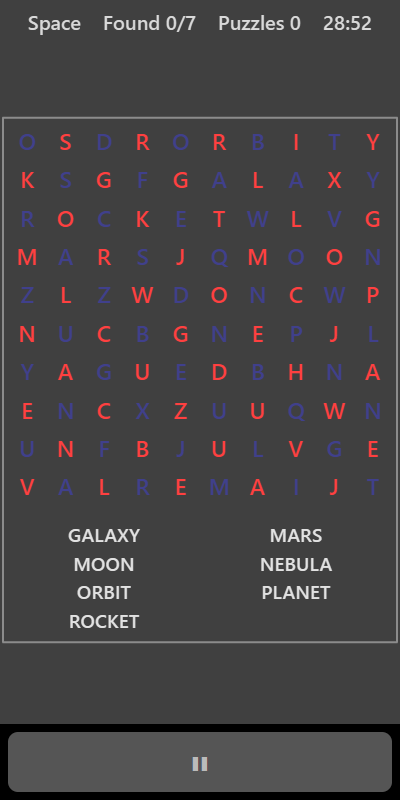

[Home](../../README.md) > [Words](README.md) > Word Search

Word Search hides a list of words on one theme in a square grid of letters. The words can run across, down or diagonally, and on Hard they can also run backwards. The list of words to find is shown under the grid.

## How to play

1. Tap **Play**. The theme is shown in the top bar.
2. Find a word from the list in the grid.
3. Put your finger on its first letter and drag to its last letter, then let go.
4. If the letters you covered spell a word on the list, it's circled in the grid and crossed off the list.
5. Find every word and a new puzzle with a new theme appears.

## Controls

| Action        | Touch                                  | Keyboard    | Controller |
|---------------|----------------------------------------|-------------|------------|
| Select a word | Drag from the first to the last letter | None        | None       |
| Pause         | ❚❚                                     | P or Escape | Start      |

The selection only follows straight lines: across, down or exactly diagonal. Word Search needs touch, so it can't be played in split-screen mode with a controller.

## What each eye sees

Letters alternate between your eyes like a chessboard. Half the grid is shown to your weaker eye and half to your stronger eye, so you need both to read any word. The word list and the circles round found words are shown to both eyes.

## Difficulty

| Setting | Grid     | Words | Directions                                  |
|---------|----------|-------|---------------------------------------------|
| Easy    | 8 × 8    | 5     | Across and down                             |
| Normal  | 10 × 10  | 7     | Across, down and diagonal                   |
| Hard    | 12 × 12  | 9     | Any direction, including backwards          |

## Scoring

The top bar shows the theme, how many words you've found and how many puzzles you've completed.

## Tips

* Look for unusual letters in a word, like Z, K or two of the same letter together, and scan for those.
* Work through the list one word at a time rather than hunting for any word.
